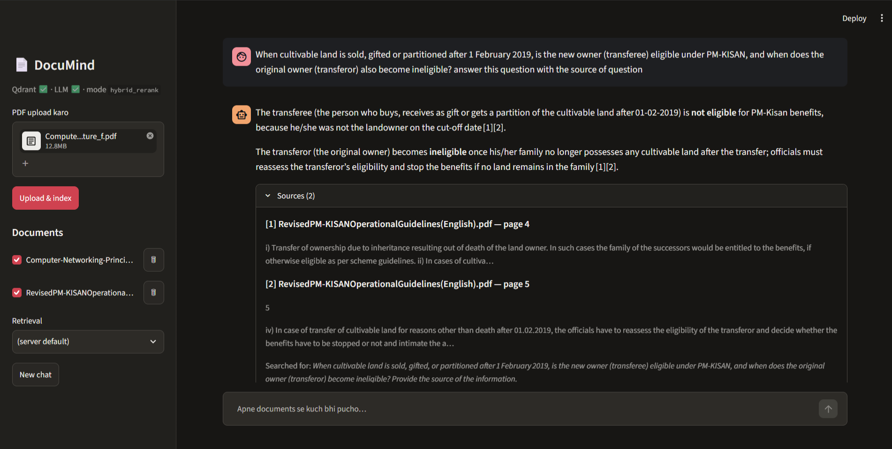
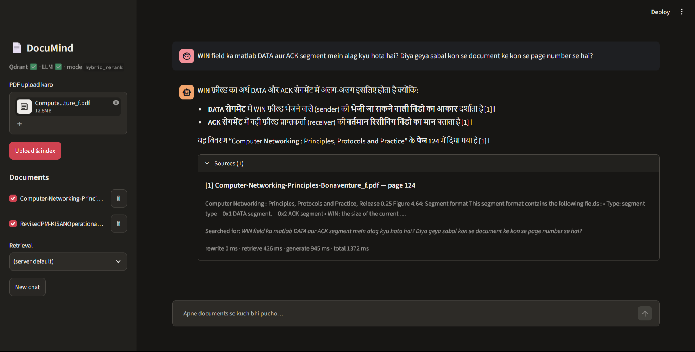
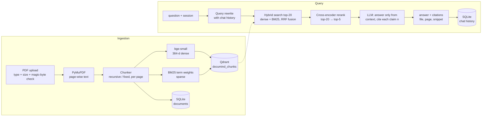

# DocuMind — RAG Document Q&A with page-level citations

Upload PDFs (semester notes, syllabus, government scheme documents) and ask questions in English, Hindi or Hinglish.
Every answer cites the **file and page** it came from, and says *"Document mein nahi mila."* when the answer isn't there.






**Stack:** FastAPI · LangChain · Qdrant (dense + BM25 sparse) · `bge-small-en-v1.5` embeddings · `bge-reranker-base` cross-encoder · Groq (Gemini fallback) · SQLite · Streamlit · LangSmith · Docker

## Results

36 questions over 2 public PDFs (an open networking textbook, 282 pages, and the PM-KISAN operational guidelines);
1,322 chunks; every question is searched across **all** documents. A hit means the labelled page is in the top-k.

| Chunking | Retrieval | Hit@1 | Hit@5 | MRR@5 | p50 latency |
|---|---|---|---|---|---|
| fixed | dense | 69% | 100% | 0.820 | 21 ms |
| fixed | hybrid | 72% | 97% | 0.819 | 51 ms |
| fixed | hybrid + rerank | 86% | 100% | 0.919 | 256 ms |
| recursive | dense | 78% | 100% | 0.870 | 23 ms |
| recursive | hybrid | 78% | 100% | 0.866 | 53 ms |
| **recursive** | **hybrid + rerank** | **94%** | **100%** | **0.963** | 262 ms |

**Answer quality** (recursive + hybrid + rerank, LLM-as-judge): faithfulness 100% · citation page accuracy 97% ·
"not found" on 1/36.

What this shows, and what it doesn't:
- **Reranking is the biggest win**: Hit@1 78% → 94% for ~240 ms extra latency. Recursive chunking beats fixed-size
  windows on its own (Hit@1 69% → 78% with dense retrieval).
- **Hit@5 saturates** on this set, so Hit@1 and MRR are the metrics that separate the configurations.
- **Hybrid search shows no gain here.** The questions were LLM-drafted from the target page (then spot-checked), so
  they already share vocabulary with it, which favours dense retrieval. BM25 earns its keep on exact tokens
  (scheme names, codes, numbers) that this set under-represents.
- Small set (36 questions); the judge is an LLM and tends to be lenient. Reproduce with `python -m eval.run_eval`.

## Architecture



## Quick start

**Local (no Docker)** — Qdrant runs embedded on disk, so nothing else to install.

```powershell
python -m venv .venv
.venv\Scripts\activate            # Linux/macOS: source .venv/bin/activate
pip install -r requirements-dev.txt
copy .env.example .env            # then put GEMINI_API_KEY (and/or GROQ_API_KEY) in .env

uvicorn app.main:app --reload     # API on http://localhost:8000  (docs: /docs)
streamlit run ui/streamlit_app.py # UI on http://localhost:8501  (second terminal)
```

First start downloads the embedding (~130 MB) and reranker (~1.1 GB) models from Hugging Face.
With an NVIDIA GPU, install the CUDA build of PyTorch first for faster ingestion and reranking.

**Docker** — API + Qdrant server + UI:

```bash
cp .env.example .env   # add your keys
docker compose up --build
```

## API

| Method | Path | Body | Returns |
|---|---|---|---|
| POST | `/documents` | multipart PDF | `{doc_id, filename, pages, chunks, duplicate}` |
| GET | `/documents` | – | list of documents |
| DELETE | `/documents/{doc_id}` | – | 204; removes vectors (Qdrant) and metadata (SQLite) |
| POST | `/chat` | `{question, session_id?, doc_ids?, mode?}` | `{answer, citations[], session_id, rewritten_question, timings_ms}` |
| GET | `/sessions/{id}` | – | chat history |
| GET | `/health` | – | API / Qdrant / LLM status |

```bash
curl -F "file=@notes.pdf;type=application/pdf" localhost:8000/documents
curl -H "Content-Type: application/json" -d '{"question":"Bernoulli equation kya hai?"}' localhost:8000/chat
```

## Evaluation

```bash
# 1. Put 2–3 PDFs in eval/pdfs/
# 2. Draft questions with the LLM, then REVIEW and fix them by hand
python -m eval.draft_questions --per-doc 20
#    → edit eval/testset.draft.json, save as eval/testset.json  (format: eval/testset.example.json)
# 3. Run: fixed vs recursive chunking × dense / hybrid / hybrid+rerank
python -m eval.run_eval
python -m eval.run_eval --faithfulness     # + LLM-as-judge on recursive:hybrid_rerank
```

Writes `eval/results/RESULTS.md` (table above) and a JSON file with per-question ranks.
Metrics: **Hit@k** (correct page in the top-k), **MRR@5**, retrieval latency p50/p95, **faithfulness** (judge says every
claim is supported by the retrieved context), **citation page accuracy** (a cited page is the labelled one).

## Design decisions

- **Chunks never cross a page.** Every chunk has exactly one page number, so citations are exact.
  The cost is that a few sentences split at page breaks lose context; with 800-char chunks, that's a small loss.
- **Why hybrid search?** Dense embeddings match meaning ("pressure drops when speed rises") but miss exact
  tokens: formulas, section numbers, scheme names like *PM-KISAN*, Hinglish words. BM25 catches those. The two
  lists are fused with **Reciprocal Rank Fusion inside Qdrant** (one round-trip, no score calibration needed).
- **BM25 without a model download.** Documents store BM25-saturated term frequencies; Qdrant's `IDF` modifier
  applies IDF at query time, so scores stay correct as documents are added or deleted. The tokenizer keeps
  Devanagari words intact.
- **Why a reranker?** Bi-encoders embed query and chunk separately. A cross-encoder reads them together and is much
  more precise, but slow, so it only reranks the top 20 candidates.
- **Query rewriting** turns "aur iska formula?" into a standalone question. It's skipped on the first turn
  to save latency and free-tier quota, and falls back to the raw question if the LLM call fails.
- **Groq → Gemini fallback** via LangChain `with_fallbacks`, so a free-tier 429 doesn't take the app down.
- **Duplicate uploads** are detected by SHA-256 and return the existing document instead of re-indexing.

## Security

- Keys only in `.env` (git-ignored); `.env.example` is the template. Empty values mean "not set".
- Upload checks: content-type **and** `%PDF-` magic bytes, size limit read without buffering the whole body,
  page limit, encrypted/scanned PDFs rejected with a clear 422, filenames sanitised.
- Prompt-injection defence: document text is fenced in `<context>` (fence-closing tags are escaped), and the system
  prompt says that text is data, not instructions. Invalid citation numbers are stripped.
- Optional `API_KEY` (constant-time compare) and per-IP rate limiting on upload/chat; LLM request timeouts.
- Logs contain document IDs and counts, never document text or keys.

## Project structure

```
app/
  main.py  config.py
  api/        documents.py chat.py health.py security.py schemas.py
  ingestion/  parser.py chunker.py embedder.py pipeline.py
  retrieval/  qdrant_store.py sparse.py hybrid.py reranker.py
  llm/        prompts.py chain.py rewriter.py
  services/   container.py chat.py
  db/         models.py crud.py
ui/streamlit_app.py
eval/  run_eval.py draft_questions.py metrics.py testset.example.json
tests/ (offline: fake embedder/reranker/LLM + in-memory Qdrant & SQLite)
```

## Tests

```bash
pytest          # runs offline in about 1 s, no API keys or model downloads
ruff check .
```

## Tracing

Set `LANGSMITH_TRACING=true` and `LANGSMITH_API_KEY` in `.env`. Each chat turn shows up as one trace with
`rewrite_query → retrieve → rerank → generate_answer` spans, including latency and token counts.
